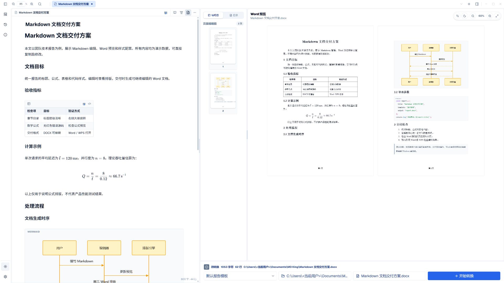
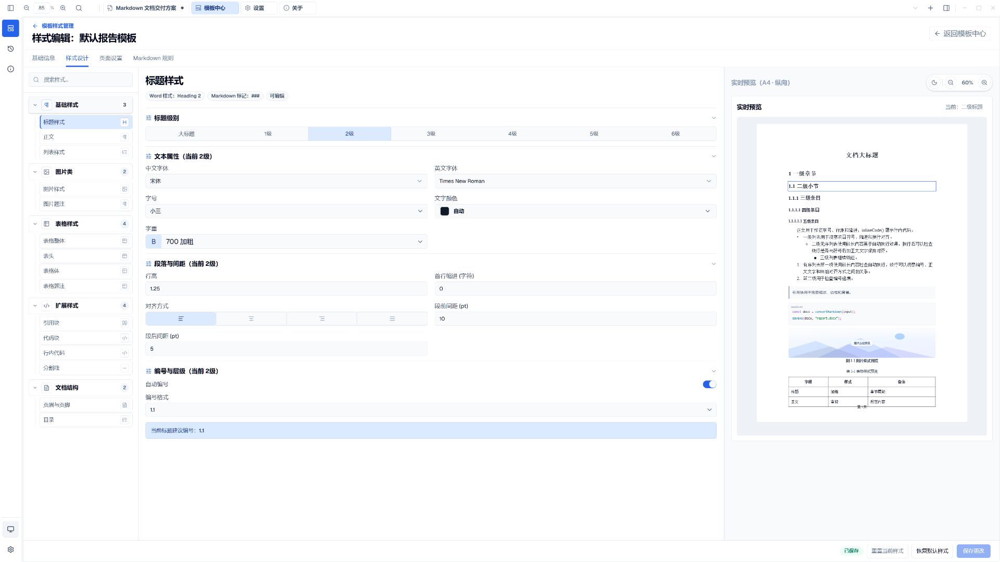
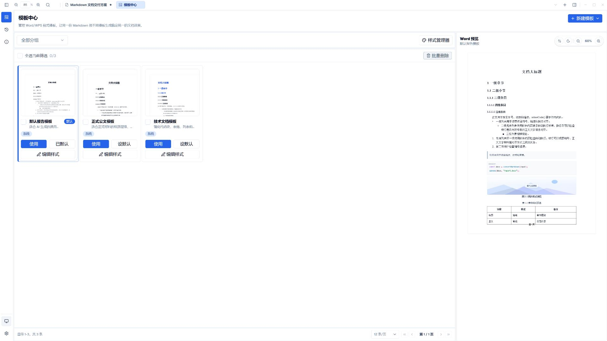
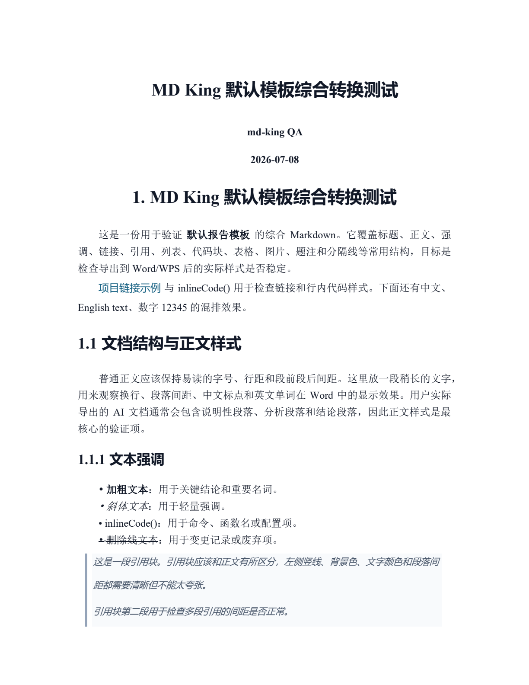
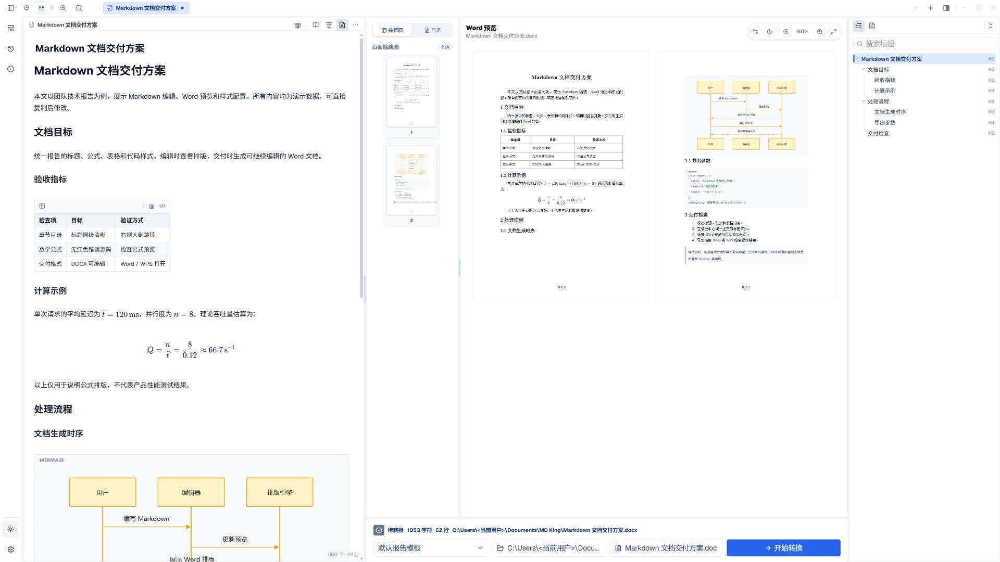
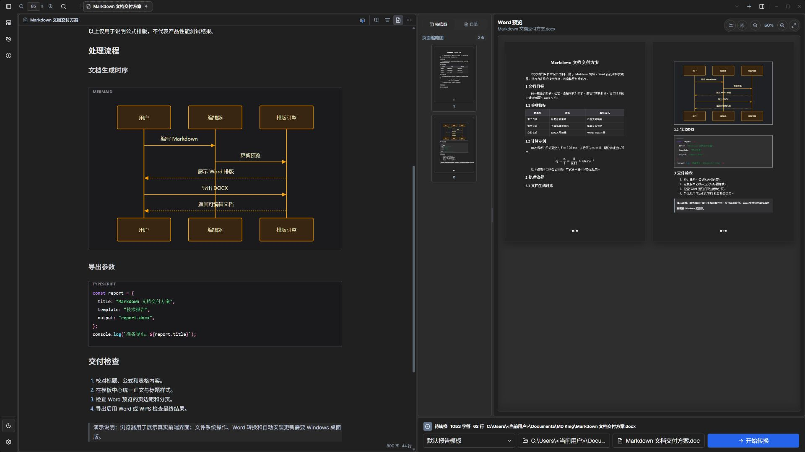
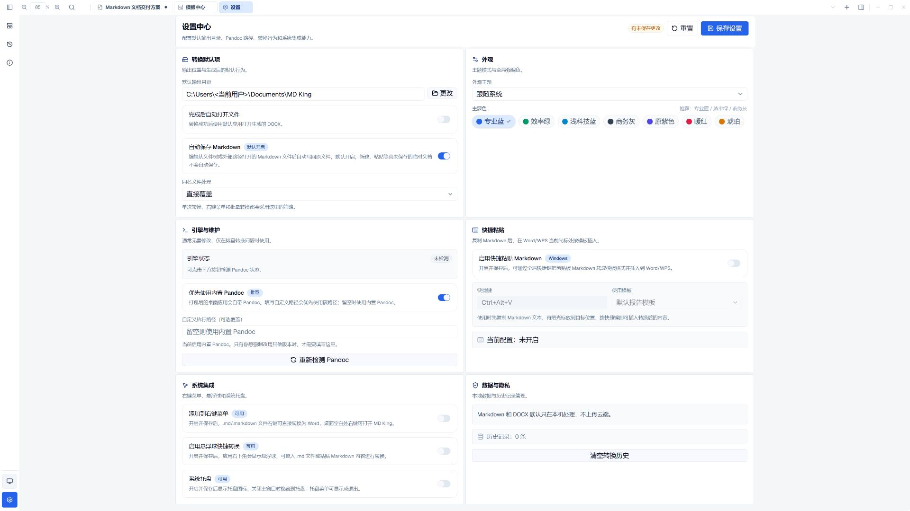
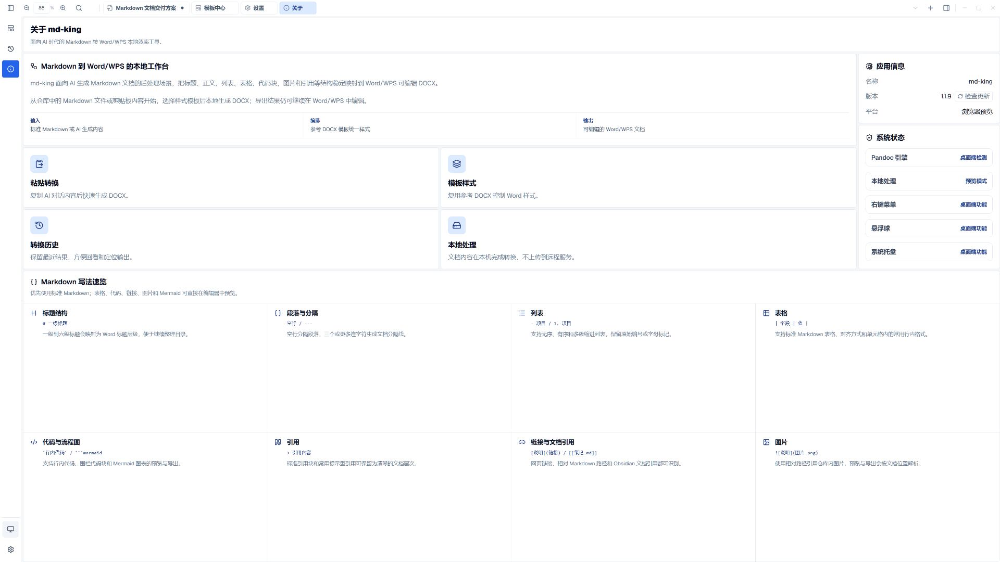
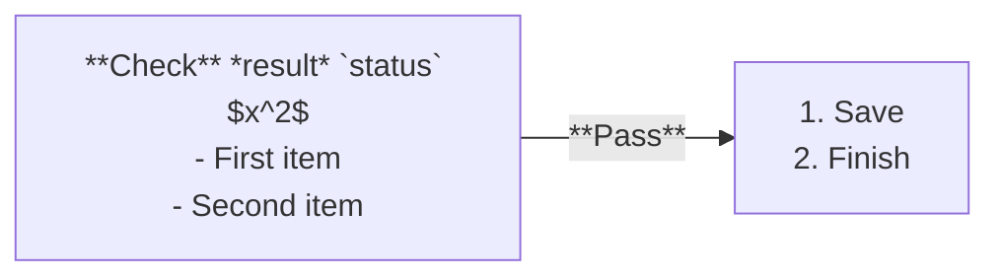

<p align="center"><a href="README.md">简体中文</a> | <strong>English</strong></p>

<div align="center">


# MD King · Markdown Editor and Markdown-to-Word Converter

**Write in Markdown. Export editable Word / WPS documents using your own templates.**

[](https://github.com/GuoWWWX/md-king/releases)
[](https://github.com/GuoWWWX/md-king/releases/latest)
[](LICENSE)

<p align="center">
  <a href="https://github.com/GuoWWWX/md-king/releases/latest"><strong>Download for Windows</strong></a> •
  <a href="#quick-start">Quick start</a> •
  <a href="#features">Screenshots</a> •
  <a href="https://github.com/GuoWWWX/md-king/issues">Report an issue</a> •
  <a href="#development">Development</a>
</p>

</div>

MD King is a local Windows desktop app with two main functions:

| Function | What you can do |
| :--- | :--- |
| Markdown editor | Manage documents in a file tree, navigate by outline, and preview tables, LaTeX equations, and Mermaid diagrams. Includes light and dark modes. |
| Markdown to Word / WPS | Export `.md` to editable `.docx`. Customize fonts, sizes, spacing, indentation, margins, and heading numbers, then reuse these settings across documents. |

Use it for technical proposals, work reports, or paper drafts: organize content in Markdown, then deliver a formatted Word document. Markdown from ChatGPT, Claude, DeepSeek, and other tools can be edited and exported too. Editing and conversion happen on your computer without uploading document contents.

The writing layout has a file tree on the left, Markdown in the middle, and a heading outline on the right. Word preview can be opened from the toolbar; it is hidden in this screenshot.



<a id="download"></a>

## Download and install

Supports **Windows 10 / 11, x64**. Open the [latest release](https://github.com/GuoWWWX/md-king/releases/latest), download `md-king_<version>_x64-setup.exe`, and run it. Pandoc is bundled; no development environment is needed.

Existing EXE installations support in-place upgrades. Updates can also be installed from inside the app. Releases include an MSI installer and verification files.

Choose **English** or **简体中文** from the language button near the bottom of the left activity bar. Changes apply immediately and are remembered. The update button is above the language button; the theme button is below it. Switching languages leaves your document contents, custom template names, and formatting settings unchanged.

<a id="quick-start"></a>

## From Markdown to Word

Try the [sample technical report](docs/examples/technical-report.md) (Chinese). It includes nested headings, tables, equations, a Mermaid sequence diagram, and code blocks.

1. Open the `.md` file, edit its content, and navigate using the outline.
2. Choose a preset in Templates, create your own template, or import styles from an existing `.docx`.
3. Open the style manager to adjust heading numbers, Chinese and Latin fonts, font sizes, spacing, and page settings. Save the template.
4. Export `.docx`, then check the layout in Word / WPS and continue editing or share the result.

The same report can use a team report template or a course paper template without manually restyling each document. Imported DOCX files supply reference styles; their body text is not copied into the output.

References to sections, paragraphs, and line ranges work within a document or across files in the same workspace. Hover to preview; click to jump and select the referenced content. Examples:

```markdown
[[design.md#Deployment]]
[[design.md#^rule]]
[[design.md#L127-L130]]
[Implementation details](design.md#L127-L130)
```

References work in body text, tables, block quotes, bold, and italic text. Right-click to copy references. Line ranges can display as `line 127-130`. See the [Markdown syntax and reference guide](docs/markdown-syntax.md) (Chinese), or the syntax overview in About.

<a id="features"></a>

## Features

### Custom Word / WPS styles

Configure titles, heading levels 1–6, body text, lists, code blocks, tables, and pages. Set Chinese and Latin fonts, sizes, weights, indentation, spacing, and multilevel heading numbering. Saved styles are reused on later exports.



### Template library

Choose report, formal document, and technical document presets. Create custom templates or import DOCX reference styles. Organize templates into groups and set a default.



### Word output

Export headings, tables, diagrams, and captions to editable DOCX. The image below shows a previously generated document. Check actual pagination in your target Word / WPS environment.



<details>
<summary>More screenshots: outline, dark mode, settings, and updates</summary>

### Outline navigation

Navigate long documents using nested headings in the right sidebar.



### Dark mode

The editor supports light and dark modes. Mermaid backgrounds and labels adapt to the theme while code blocks retain syntax highlighting.



### Settings

Configure output folders, themes, shortcuts, and the Pandoc engine.



### About and updates

View version information, browse Markdown syntax, and check for updates in the Windows desktop app.



</details>

Screenshot notes: the seven application screenshots show the v1.1.9 production frontend running in a browser at 1920 × 1080, using the sample report. They use the Chinese interface and predate the language selector. The first file tree is browser sample data. The DOCX screenshot retains its original page proportions. Browser mode demonstrates the frontend; file operations, Pandoc conversion, system integration, and update installation run in the Windows desktop app.

## More capabilities

The CLI supports conversion, diagnostics, and DOCX template import/replacement. Run `md-king-cli --help` or read the [CLI guide](docs/cli.md) (Chinese). After editing a template in Word/WPS, use `templates replace` to retain its ID and refresh its styles.

- Inline and display LaTeX, Mermaid flowcharts and sequence diagrams, syntax highlighting, tables, task lists, and callouts.
- Windows context menus, global `Ctrl+Alt+V` quick paste, and a floating converter.
- Chinese and English interfaces with immediate switching and persistent selection.
- Update notifications, download progress, cancellation, resuming, and retries.

### Markdown inside Mermaid labels

Text labels across Mermaid diagram types support bold, italic, inline code, math, and ordered or unordered lists, including flowchart nodes, edges, subgraph titles, and sequence messages. Follow each diagram's own label syntax and use `<br/>` for line breaks:

````markdown

````

For example, a sequence message can be written as ``A->>B: **Request** `id` $x^2$<br/>- First<br/>- Second``; quote quadrant point names containing formatting symbols. Math accepts `$...$` and Mermaid's native `$$...$$`, and Mermaid's quoted-backtick Markdown labels are also supported. An explicit `htmlLabels: false` retains Mermaid's native behavior, which may limit rich formatting. Word/WPS exports use PNG for these labels; the CLI falls back to PNG for such diagrams when SVG is requested.

## Automatic updates

The app checks for updates three seconds after startup, when restored from the tray, when an existing instance is launched again, and every four hours while running. You can also check manually from the left activity bar or About.

When a new version is available, open the sidebar notification to review release notes. Updating shows downloaded bytes, percentage, and speed. The client verifies the signature and installer hash, saves the draft session, then starts an in-place upgrade and restarts. Windows permission prompts may require user confirmation.

You can check for a newer release during a download. The old download cache is cleared only when you choose to download the newer version. Downloads of the same version resume after cancellation, a connection interruption, or a restart. Windows downloads follow the system proxy.

Compatible clients prefer a binary delta when the cached old installer matches. They reconstruct and verify the full installer before installation, falling back to a full download when needed. Older clients require a full package for their first upgrade. Pandoc is reused when its version is unchanged and its local file exists; missing or updated versions are installed automatically.

<details>
<summary>Verification and failure handling</summary>

Updates come only from stable releases in this repository. The client verifies an Ed25519 manifest signature against its pinned public key, then checks installer size and SHA-256. Failed verification blocks installation. If draft storage or installer launch fails, the current app stays open for a retry. Network failures do not close the app.

</details>

<a id="development"></a>

## Development

- **`main`** stays stable and releasable. Releases have matching Git tags.
- **`develop`** receives daily development and feature pull requests.

### Run and build locally

Requires Node.js 24.3+, pnpm 10.33.0, Rust stable, and Git LFS. Windows desktop builds also need the Visual Studio C++ toolchain and Windows SDK. At release time, `main` and `develop` point to the same commit; during development, `develop` may be ahead.

```bash
git clone https://github.com/GuoWWWX/md-king.git
cd md-king
git lfs pull
pnpm install --frozen-lockfile

# Frontend development
pnpm dev

# Tauri desktop development
pnpm tauri dev

# Production installers
pnpm tauri:build
```

### Project layout

| Directory | Contents |
| :--- | :--- |
| `src/` | React pages, components, stores, translations, and frontend utilities. |
| `src-tauri/src/` | Rust commands, conversion, storage, system integration, and CLI. |
| `src-tauri/resources/`, `src-tauri/icons/` | Bundled Pandoc, Mermaid, default Word template, and icons. |
| `public/` | Frontend static resources. |
| `scripts/` | Development startup, Windows builds, installer patches, and update signing. |
| `tests/browser/` | Browser regression tests and fixtures. |
| `tests/fixtures/conversion/` | Markdown and image fixtures for conversion checks. |
| `docs/` | Product, architecture, design, and release documentation, mainly in Chinese. `images/` contains README screenshots. |

Local logs and temporary QA output belong in ignored `.codex/`. Build output is in ignored `dist/` and `src-tauri/target/`. Publish EXE/MSI installers to GitHub Releases, not the source repository.

### Tests and releases

```powershell
pnpm build
pnpm test:unit
pnpm test:release
# Windows MSVC environment wrapper
pnpm test:msvc
scripts\cargo-msvc.bat tauri-build
```

Windows installers are generated under `src-tauri/target/release/bundle/nsis/` and `src-tauri/target/release/bundle/msi/`. Upgrades use the running executable’s installation directory.

CI checks the frontend build, unit tests, and Rust tests on pull requests and `develop`. For the same commit, `main` reuses validated `develop` checks and frontend artifacts, then builds EXE/MSI installers once. Release reuses those validated installers and generates deltas, signatures, and checksums. Missing or expired artifacts trigger a full build; mismatched versions, commits, or hashes stop the workflow. The installer is compressed only once. See [release maintenance](docs/RELEASING.md) (Chinese).

The client public key is in `src-tauri/update-public-key.txt`. The GitHub secret `UPDATE_SIGNING_PRIVATE_KEY` holds the matching Base64-encoded Ed25519 PKCS#8 private key. Never commit the private key. Signing checks the key pair and release version before publishing.

## License

[MIT](LICENSE). Issues and pull requests are welcome.
